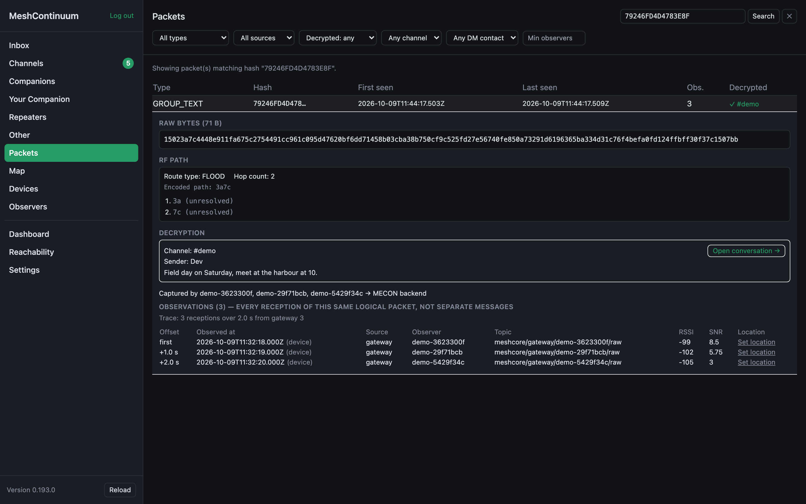
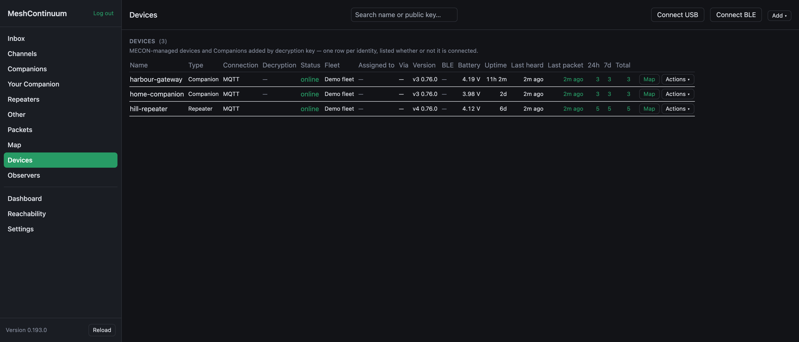

# MeshContinuum

## What if your MeshCore radios worked together?

A MeshCore radio knows only what it heard itself, while it was on and in range. MeshContinuum (MECON) explores what becomes possible when independent radios, observers, identities and sites pool what they hear, while every radio stays an ordinary MeshCore device that works without MECON or the Internet.

MECON is an independent, non-commercial experiment. It exists to try these ideas, share what is learned and invite others to reuse and improve them. It has no revenue objective.

> **Where things stand:** MECON runs as a private beta on [mecon.cloud](https://mecon.cloud), by invitation. The firmware is public as source and signed pre-releases. The Backend and Reader are not published yet. Some of what follows, such as the fleet channel and delegated identities, is planned work. [Availability →](docs/CAPABILITIES.md)

## Four things it makes possible

**1. One network, many receivers.** Your Companion was off overnight, but the home gateway, a hilltop Repeater's observer and a community feed all heard the message to you. MECON keeps it once, with each reception as evidence: which observer heard it, by which path, at what signal strength. History lives with your installation, not in one phone app.

**2. See how your mesh really reaches.** Which Repeaters actually carry your traffic, where paths break, and which nodes only one observer ever hears. Many observers' receptions show coverage and its limits, honestly: MECON shows only what its sources heard.

**3. Look after a fleet, even where there is no Internet.** Health, battery, firmware and last-heard for every device in one list. Configure and update supported Companions, Repeaters and Room servers. A Repeater on a mountain with no IP link is still reached over LoRa, with signed management, and reports in on a schedule over its fleet's private management channel.

**4. Your identities, wherever you are.** Read your messages from any browser, and send through a Companion at home. A Companion you carry can also receive messages for your car, cabin or spare Companion, so a message to any of them reaches you in the stock app.

One message, kept once, with every reception that heard it, and every device's connection and health in one list.
*Captured 9 October 2026 in the real application, MECON v0.193.0, with synthetic demo data: the devices, names, places and messages are made up.*

## What stays the same

MECON is not a new radio protocol. Stock MeshCore devices and apps keep working with it and without it. If the Reader, the broker, the Internet or MECON itself goes away, your radios keep working. MECON never guarantees delivery, and cannot show a packet none of its sources heard. The Reader needs a Backend. A hosted service such as mecon.cloud can read what you enrol: see [trust and privacy](docs/TRUST_AND_PRIVACY.md).

## What is in this repository

| Repository | What it holds today | Licence |
|---|---|---|
| **MeshContinuum** (this one) | Documentation, the target contracts for the Backend and the mecon.cloud presentation site. The Backend and Reader are developed privately and are not published yet | Apache-2.0 |
| **[mecon-firmware](https://github.com/hoejriis/mecon-firmware)** | MeshCore firmware with secure management, diagnostics, signed updates and backend-neutral device contracts, as source and pre-releases | MIT |

The firmware is optional. Reading captured traffic with your own keys needs no special firmware. Managing a device needs it. Any manager that implements the firmware's contracts can use it, without MeshContinuum ([who does what](docs/COMPONENTS.md#who-does-what)).

## Get involved

- **Try ideas:** [describe a use case](https://github.com/hoejriis/MeshContinuum/issues/new?template=use-case.yml), or a reception, history or management problem MECON should explore.
- **Contribute:** improve documentation, review the contracts or report an unclear claim. See the [contribution guide](CONTRIBUTING.md).
- **Test:** [express beta interest](https://github.com/hoejriis/MeshContinuum/issues/new?template=beta-interest.yml). Interest is not an invitation, and no date is promised.
- **Follow:** star or watch the repository.

Public issues are public. Never post email addresses, private keys, private messages or credentials.

## Read more

- [What MECON adds](docs/WHY_MESHCONTINUUM.md) and [how it works](docs/COMPONENTS.md)
- [Deployment choices](docs/DEPLOYMENT_MODES.md) and the [mecon.cloud beta guide](docs/GETTING_STARTED.md)
- [Limitations](docs/LIMITATIONS.md), [availability](docs/CAPABILITIES.md) and the [roadmap](docs/ROADMAP.md)
- New to MeshCore? [MeshCore in brief](docs/MESHCORE.md)
- [Everything, in order](docs/README.md)

## Licence and upstream

This repository is licensed under [Apache-2.0](LICENSE). [mecon-firmware](https://github.com/hoejriis/mecon-firmware) is MIT. MECON is an independent project built around [MeshCore](https://github.com/meshcore-dev/MeshCore), not an official MeshCore service.
