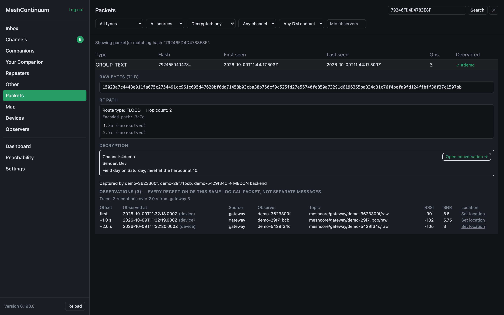
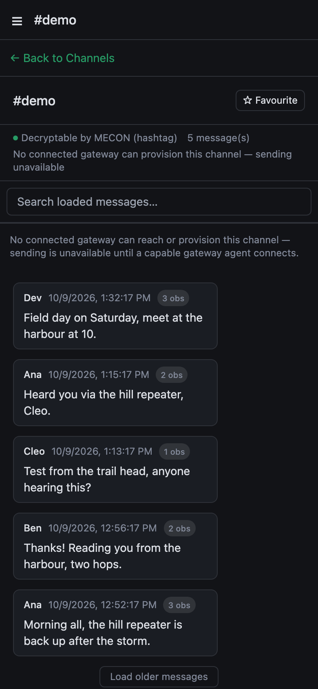
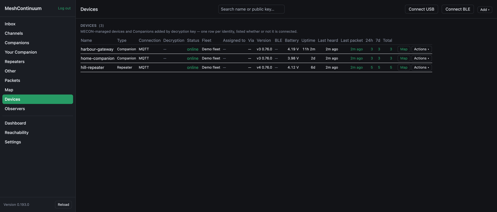
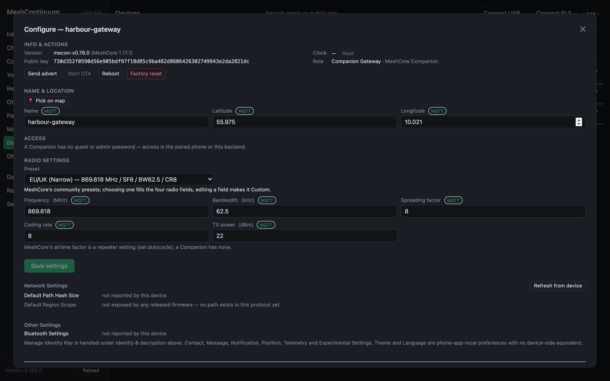

# MeshContinuum

## MeshCore, without the boundaries of a single device.

**Your mesh stays independent. MECON makes it more useful when connected.**

MeshContinuum (MECON) brings messages captured by your Companions and configured observer sources into one web Reader, with persistent history, reception details and management of supported devices. Standard [MeshCore](https://github.com/meshcore-dev/MeshCore) radio operation remains independent of MECON and the Internet.

> **Where things stand:** MECON runs as a private beta on [mecon.cloud](https://mecon.cloud), by invitation. The firmware is public as source and signed pre-releases. The Backend is not published yet. [Availability →](docs/CAPABILITIES.md)

[Follow development](https://github.com/hoejriis/MeshContinuum) · [Express beta interest](https://github.com/hoejriis/MeshContinuum/issues/new?template=beta-interest.yml) · [Read the roadmap](docs/ROADMAP.md)

## Who it helps

A MeshCore radio only knows what it heard itself, while it was on and in range. MECON is for MeshCore users who want their messages on every device, with history that does not depend on one radio. It is also for operators who look after Repeaters and gateways they cannot easily reach, and for communities who want to see how their mesh really performs. New to MeshCore? Start with [MeshCore in brief](docs/MESHCORE.md).

## One Reader, more reception

At home, on the move or with several Companions: read traffic captured by the sources available to your deployment, rather than only by the radio beside your phone. Several observations of one packet become reception evidence, not several copies of the same message.

Enroll an identity or channel you are authorized to use to read its captured traffic. An enrolled Companion can be switched off while another configured observer hears a message for it. MECON cannot recover a packet that none of its sources received.

One message, kept once, with every reception that heard it, on a desktop or a phone.
*Captured 9 October 2026 in the real application, MECON v0.193.0, with synthetic demo data: the devices, names, places and messages are made up. Signed in, you see live traffic instead.*

## Manage devices remotely

Check health and connectivity, inspect reception, and configure supported Companions and Repeaters. Send through an authorized Companion gateway. Firmware, board, role and advertised capabilities determine which actions are available; a Repeater is not a Companion sending identity.

Connection and health for every device in one list, and a supported device's settings read from it and written back over its connection. The actions available depend on the device, its role and its firmware.
*Captured 9 October 2026 in the real application, MECON v0.193.0, with synthetic demo data: the devices, names, places and messages are made up. Signed in, you see live traffic instead.*

## Your infrastructure, your control

MECON is free and intended for open-source release. Use a hosted service, run it on a small computer at home, or connect several sites: see [deployment choices](docs/DEPLOYMENT_MODES.md). mecon.cloud is one deployment, not a required service.

Ordinary MeshCore radio use never depends on MECON. If the Reader, the broker, the Internet or MECON itself goes away, your radios keep working.

## Two projects, one clear boundary

| Project | Responsibility | Licence |
|---|---|---|
| **MeshContinuum** (this repo) | Backend, web Reader and broker and deployment integration | Apache-2.0 |
| **[mecon-firmware](https://github.com/hoejriis/mecon-firmware)** | Optional MeshCore firmware with secure management, diagnostics and signed updates, and the open device contracts | MIT |

MECON firmware is not required for ordinary MeshCore use or for reading captured traffic with authorized keys. Managed device features need compatible firmware or a supported bridge. The firmware contracts are backend-neutral: mecon.cloud is one deployment, not a required service. The MeshContinuum Reader needs its Backend, and bridges USB and BLE to it. A manager that implements the firmware contracts itself needs neither. What the firmware does is described in its own [documentation](https://github.com/hoejriis/mecon-firmware#readme).

The firmware offers generic capabilities a manager asks for, such as sending a message and reporting what became of it. Which gateway to use, which history to catch up on and how to run a Deployment are the Backend's ([who does what](docs/COMPONENTS.md#who-does-what)).

## Get involved now

- **Future tester:** [tell us your use case](https://github.com/hoejriis/MeshContinuum/issues/new?template=beta-interest.yml). Interest is not an invitation or a waiting-list guarantee; no date is promised.
- **Mesh operator:** describe a reception, history or device-management problem MECON should solve.
- **Contributor:** improve documentation, review contracts or report an unclear claim. [Contribution guide](CONTRIBUTING.md).
- **Following along:** star the repository and use GitHub Watch for the updates you want.

Public issues are public. Do not post email addresses, private keys, private messages or credentials.

## Explore

1. [MeshCore in brief](docs/MESHCORE.md): new to MeshCore? Start here.
2. [What MECON adds](docs/WHY_MESHCONTINUUM.md) and [how it works](docs/COMPONENTS.md)
3. [Deployment choices](docs/DEPLOYMENT_MODES.md) and the [mecon.cloud beta guide](docs/GETTING_STARTED.md)
4. [Limitations](docs/LIMITATIONS.md), [availability](docs/CAPABILITIES.md) and the [roadmap](docs/ROADMAP.md)
5. [Everything, in order](docs/README.md)

## License and upstream

MeshContinuum documentation is licensed under [Apache-2.0](LICENSE), continuing the application's established licence. Public application source has not yet been published. [mecon-firmware](https://github.com/hoejriis/mecon-firmware) publishes its source under MIT.

MECON is an independent project built around MeshCore, not an official MeshCore service.
