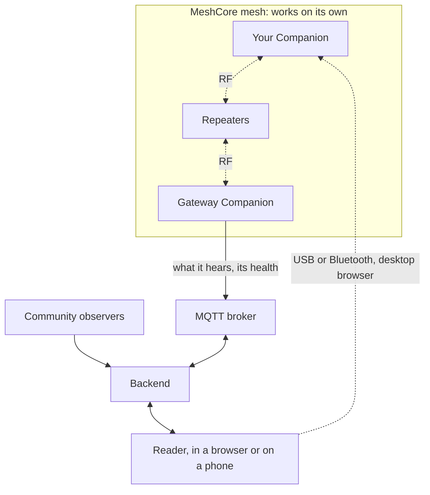

# How MECON works

MECON has three parts that you run, or that a hosted service runs for you, plus optional firmware for your radios.

| Part | What it does |
|---|---|
| **Backend** | Takes in what every source heard, recognises one message heard many times, decrypts the traffic you are authorised to read, keeps history, and runs device jobs such as configuration and updates. |
| **Reader** | The web app you use, in a browser or installed on a phone: messages, channels, reception details, devices and their settings. From a desktop browser it can also attach a radio directly over USB or Bluetooth, and pass it through to the Backend. |
| **MQTT broker** | The transport between devices, observers and Backends. It carries messages. It is not where anything is kept. |
| **[mecon-firmware](https://github.com/hoejriis/mecon-firmware)** (optional) | MeshCore firmware with secure management, telemetry and signed updates added. It is a separate open-source project, and any manager that implements its contracts can use it, not only MECON. |

## Backend

The Backend owns the application's records: packets, each observation of them, decrypted messages, device state, delivery jobs, and synchronisation with other Backends. Observer feeds and compatible devices come in through ingestion adapters that check what they receive.

It manages devices through the public device contract in mecon-firmware. MeshContinuum keeps no competing private protocol of its own.

## Reader

In the Reader you:

- read your inbox, channels and history;
- see each message's reception: which observers heard it, along which path, how strongly;
- add devices, flash and configure supported boards, and update their firmware;
- set a gateway's Wi-Fi and broker profiles;
- check health and connectivity, and get alerts.

The Reader always works through its Backend. Attaching a radio over USB or Bluetooth needs desktop Chrome or Edge, where the board supports it. What the Reader offers for a device comes from what that device reports it can do, not from its role or firmware version alone.

## MQTT broker

MQTT is transport, not the record. A device keeps one broker session at a time and fails over between its broker profiles in priority order. The public firmware holds up to six profiles (see its [MQTT page](https://github.com/hoejriis/mecon-firmware/blob/main/docs/MQTT.md)). Each profile has its own credentials, so being allowed to publish observations does not mean being allowed to send messages or manage devices.

An installation can run its own broker or use any compatible MQTT service. mecon.cloud is one hosted deployment, not part of the protocol.

## mecon-firmware

The public firmware keeps native MeshCore working and adds structured management, telemetry and signed updates. On the Heltec boards it also adds Wi-Fi and MQTT. It is verified on real hardware on four boards: Heltec V3, Heltec V4, Seeed Wio Tracker L1 and SenseCAP T1000-E. Other boards get software verification only. What each board and role can do is in the firmware's [supported hardware](https://github.com/hoejriis/mecon-firmware/blob/main/docs/SUPPORTED_HARDWARE.md). Repeaters and Room servers have no Bluetooth, by design: they are managed over USB locally.

The firmware's contracts live in its own repository, so other projects can build compatible managers without MeshContinuum.

## Who does what

| Layer | Examples | Where it lives |
|---|---|---|
| Generic capability | Native send with correlated outcomes, collecting received messages, contact and channel administration, supplying a missed message to the local app, bounded standing instructions, compact telemetry | The firmware, for any conforming manager |
| Autonomous firmware process | Outage forwarding, where the device acts by itself under stated criteria | The firmware, as separate later work |
| Backend orchestration | Which gateway sends a message, which history to catch up on, Deployment journeys, RF health policy, carrying favourite channels between devices | The Backend |

## Other sources and managers

MeshContinuum can read third-party packet sources where an adapter exists. Reading a source never grants authority to manage it. The other way round, a third-party Backend can manage mecon-firmware devices if it implements the public contract and is given that authority explicitly.

For the full design, see the [architecture](ARCHITECTURE.md).
